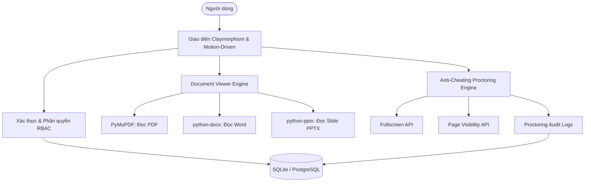

# 💻 HỆ THỐNG HỌC TẬP TRỰC TUYẾN TIN HỌC 11 (ỨNG DỤNG)
> **Đồ án môn học:** Phát triển phần mềm mã nguồn mở (PTPM.MNM)  
> **Ngôn ngữ & Nền tảng:** Python / Flask / SQLite / PyMuPDF / python-docx / python-pptx  
> **Phong cách thiết kế:** Motion-Driven + Claymorphism 3D  
> **Bản quyền:** MIT License (Mã nguồn mở 100%)

---

## 🌟 Điểm nổi bật của Dự án

1. **Thiết kế Claymorphism & Motion-Driven:**
   - Giao diện 3D đất sét mềm mại (Claymorphism) với các khối bo tròn, đổ bóng đa tầng (inner highlights + diffuse outer shadows).
   - Hiệu ứng chuyển động vật lý mượt mà (Spring physics with `cubic-bezier(0.34, 1.56, 0.64, 1)`), bóng nền chuyển động (ambient floating blobs), hiệu ứng rung cảnh báo và radar giám sát.

2. **Trình đọc Tài liệu Trực tuyến Đa Định dạng (In-Browser Viewer):**
   - **PowerPoint (.pptx, .ppt):** Tự động phân tích từng slide và hiển thị dưới dạng Slide Deck tương tác có nút Next/Prev và phím tắt điều hướng.
   - **Word (.docx):** Phân tích các tiêu đề, đoạn văn bản, bảng biểu thành HTML chuẩn mực hiển thị trong trình đọc sách chuyên dụng.
   - **PDF (.pdf):** Xem trực tiếp tài liệu qua trình đọc tài liệu tích hợp trên trình duyệt.

3. **Phòng thi Chống gian lận Thông minh (Anti-Cheating Proctoring Engine):**
   - **Toàn màn hình bắt buộc (Enforced Fullscreen):** Tự động kích hoạt khi vào phòng thi; cảnh báo ngay khi học sinh cố tình thu nhỏ cửa sổ.
   - **Giám sát Chuyển Tab (Page Visibility API):** Ghi nhận vi phạm khi học sinh mở tab mới để tìm kiếm đáp án.
   - **Phát hiện Mất tiêu điểm (Window Blur):** Ghi nhận khi học sinh chuyển sang ứng dụng khác (Zalo, Messenger, ChatGPT).
   - **Khóa thao tác gian lận:** Vô hiệu hóa chuột phải, chặn phím tắt F12, DevTools (`Ctrl+Shift+I`), View Source (`Ctrl+U`), In ấn (`Ctrl+P`), Copy/Paste.
   - **Tự động nộp bài (Auto-Submit):** Tự động khóa và nộp bài khi số lần vi phạm vượt ngưỡng quy định.
   - **Biên bản kiểm tra thời gian thực (Proctoring Audit Log):** Giáo viên xem được chi tiết từng mốc thời gian và hành vi khả nghi của học sinh.

---

## 👥 Phân quyền Người dùng (RBAC)

| Vai trò | Chức năng chính |
| :--- | :--- |
| **Quản trị viên (Admin)** | Quản lý toàn bộ tài khoản, xem thống kê hệ thống, theo dõi nhật ký vi phạm thi cử toàn trường. |
| **Giáo viên (Teacher)** | Tạo lớp học (cấp mã mời), tạo khóa học/bài học, tải lên tài liệu PPT/DOCX/PDF, tạo đề thi trắc nghiệm, cấu hình chống gian lận, chấm điểm và xem nhật ký vi phạm của học sinh. |
| **Học sinh (Student)** | Nhập mã mời để vào lớp học, xem lý thuyết, đọc slide/tài liệu trực tuyến, làm bài kiểm tra trong môi trường giám sát an toàn. |

---

## 🏗️ Kiến trúc Hệ thống



---

## 🚀 Hướng dẫn Cài đặt & Chạy ứng dụng

### Cách 1: Chạy trực tiếp với Python (Khuyến nghị phát triển)

1. **Clone repository:**
   ```bash
   git clone https://github.com/your-username/PTPM.MNM.git
   cd PTPM.MNM
   ```

2. **Cài đặt các thư viện cần thiết:**
   ```bash
   pip install -r requirements.txt
   ```

3. **Khởi tạo cơ sở dữ liệu và dữ liệu mẫu:**
   ```bash
   python seed.py
   ```

4. **Khởi chạy máy chủ:**
   ```bash
   python run.py
   ```
   *Truy cập trình duyệt tại địa chỉ:* **`http://127.0.0.1:5050`**

---

### Cách 2: Triển khai bằng Docker Compose (Chuẩn Open-Source)

```bash
docker compose up --build
```
*Truy cập trình duyệt tại:* **`http://127.0.0.1:5050`**

---

## 🔑 Tài khoản Thử nghiệm Mặc định

Sau khi chạy lệnh `python seed.py`, hệ thống đã có sẵn 3 tài khoản mẫu:

| Vai trò | Tên đăng nhập | Mật khẩu | Chú thích |
| :--- | :--- | :--- | :--- |
| **Admin** | `admin` | `admin123` | Quản trị viên hệ thống |
| **Giáo viên** | `gv.huong` | `teacher123` | Cô Nguyễn Thị Hương (Lớp 11A1) |
| **Học sinh** | `hs.nam` | `student123` | Em Trần Văn Nam (Đã vào lớp 11A1) |

*Mã mời lớp mẫu:* **`TIN11-A1`**

---

## 🧪 Chạy Kiểm thử Tự động (Unit Tests)

Dự án tích hợp bộ kiểm thử tự động với `pytest` để kiểm tra toàn bộ luồng đăng nhập, phân quyền, quản lý lớp, upload tài liệu và cơ chế chống gian lận:

```bash
python -m pytest tests/
```

---

## 📂 Cấu trúc Thư mục Dự án

```text
PTPM.MNM/
├── .github/
│   └── workflows/ci.yml       # Tự động hóa CI/CD kiểm tra code
├── app/
│   ├── static/
│   │   ├── css/
│   │   │   ├── claymorphism.css # Hệ thống thiết kế Claymorphism 3D
│   │   │   └── motion.css       # Các hiệu ứng chuyển động và radar giám sát
│   │   └── js/
│   │       ├── anti-cheating.js # Động cơ phát hiện chuyển tab, khóa màn hình
│   │       ├── doc-viewer.js    # Trình xem slide PowerPoint tương tác
│   │       └── main.js
│   ├── templates/               # Giao diện người dùng Jinja2
│   │   ├── auth/                # Đăng nhập, Đăng ký
│   │   ├── dashboard/           # Bàn làm việc Admin, Giáo viên, Học sinh
│   │   ├── classrooms/          # Chi tiết lớp học, tham gia bằng mã
│   │   ├── courses/             # Khóa học, bài học, tải lên tài liệu
│   │   ├── materials/           # Trình xem PPTX, DOCX, PDF trực tuyến
│   │   └── exams/               # Phòng thi chống gian lận, biên bản vi phạm
│   ├── auth.py                  # Module xác thực & bảo vệ phân quyền
│   ├── models.py                # Database Schema (SQLAlchemy)
│   ├── routes.py                # Bộ điều hướng API & Web Controller
│   └── utils.py                 # Bộ giải mã tệp PPTX, DOCX, PDF
├── tests/
│   └── test_app.py              # Bộ kiểm thử tự động Pytest
├── uploads/                     # Thư mục lưu trữ tài liệu người dùng tải lên
├── config.py                    # Cấu hình hệ thống
├── Dockerfile                   # Đóng gói container Docker
├── docker-compose.yml           # Triển khai dịch vụ bằng Docker Compose
├── seed.py                      # Kịch bản khởi tạo dữ liệu mẫu
├── run.py                       # Điểm khởi chạy ứng dụng (Entrypoint)
├── requirements.txt             # Danh sách thư viện Python
├── CONTRIBUTING.md              # Hướng dẫn đóng góp mã nguồn mở
├── CODE_OF_CONDUCT.md           # Quy tắc ứng xử cộng đồng
└── LICENSE                      # Giấy phép bản quyền MIT
```

---

## 📄 Bản quyền (License)
Dự án được phân phối dưới giấy phép **MIT License**. Xem chi tiết tại [LICENSE](file:///Users/mac/Downloads/PTPM.MNM/LICENSE).
